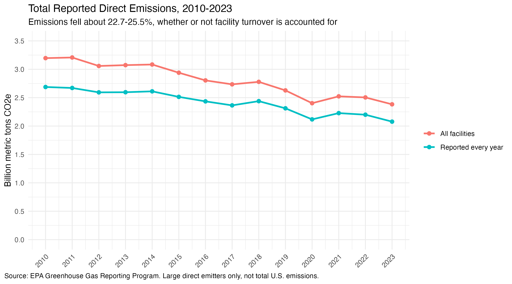
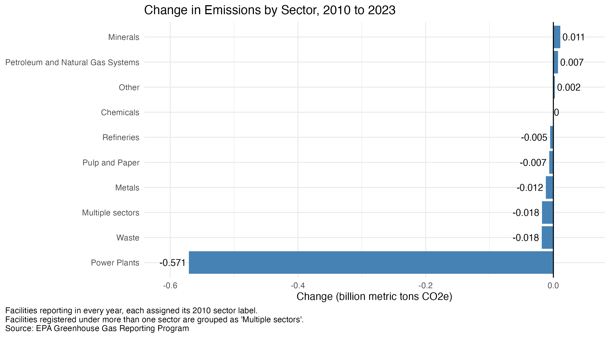
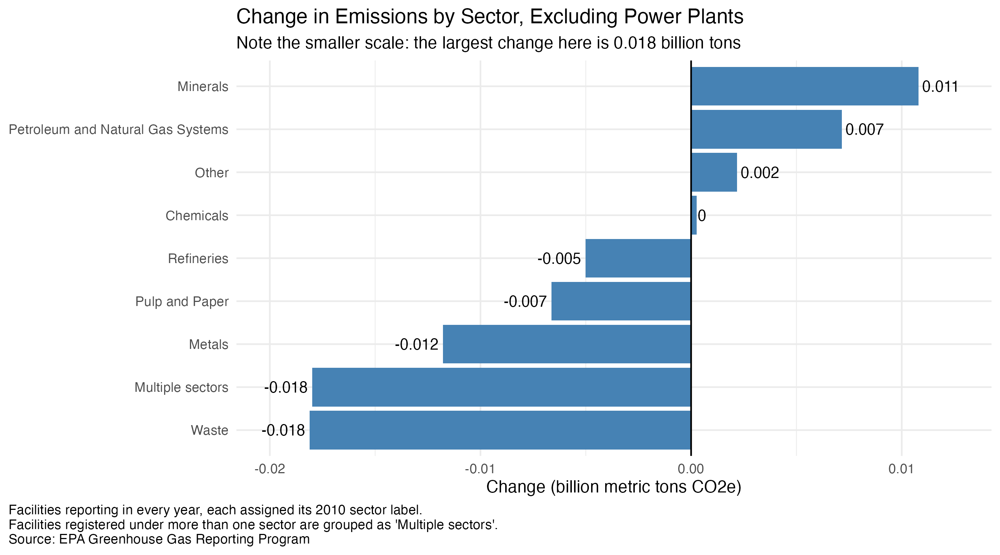

# Trends in Reported Industrial Greenhouse Gas Emissions, 2010-2023

An R analysis of EPA Greenhouse Gas Reporting Program (GHGRP) data on large direct emitters in the United States.

## Question

How did reported direct emissions change from 2010 to 2023, and how much of that change holds up when only facilities that reported in every year are included?

## Key findings

- Total reported direct emissions fell from about 3.20 to 2.38 billion metric tons CO2e (about -26%) across all reporting facilities, and from about 2.69 to 2.08 billion (about -23%) among the 4,690 facilities that reported in every year. Because the two samples (full and balanced) show similar declines, changes in which facilities report do not appear to account for the overall pattern.  
- Power plants account for about 94% of the net decline in the balanced sample (about -0.57 of -0.61 billion metric tons CO2e). Every other sector changed by less than 0.02 billion tons.
- Both samples show a dip in 2020 and a partial rebound in 2021.

## Figures

### Figure 1: Total Reported Emissions by Year

Total reported direct emissions for all reporting facilities, compared with the 4,690 facilities that reported in every year. Both series fall between 2010 and 2023 (about -26% and -23%), with a dip in 2020 and a partial rebound in 2021. The gap between the lines is emissions from facilities that did not report in every year. 

### Figure 2: Change in emissions by sector

Change in emissions from 2010 to 2023 for each sector, among facilities that reported in every year (each facility keeps its 2010 sector label). Power plants account for about -0.57 billion tons, roughly 94% of the net decline in this sample. Every other sector changed by less than 0.02 billion tons.

### Figure 3: Change in emissions by sector, excluding power plants

The same comparison without power plants, so the smaller changes are visible. The scale is much smaller than in Figure 2, so compare bars only within this figure. Some sectors rose slightly and others fell slightly. Refineries are understated because most are registered under multiple sectors. 

## Data

Source: EPA Greenhouse Gas Reporting Program, [Data Sets page](https://www.epa.gov/ghgreporting/data-sets) ("2023 Data Summary Spreadsheets," zip file).

The data are not included in this repository. To reproduce the analysis:

1. Download and unzip the 2023 Data Summary Spreadsheets.
2. Copy the yearly files (`ghgp_data_2010.xlsx` through `ghgp_data_2023.xlsx`) into `data/raw/`.

The analysis uses the Direct Point Emitters sheet (the first tab) of each yearly file.

## Method

1. **Import:** read the first sheet of each yearly file, skipping the three header rows above the column names, and stacked the years into one table (about 94,000 facility-year rows). Column types are detected from many rows, because the default (1,000 rows) misread sparse columns as TRUE/FALSE and silently turned some real values into missing values.
2. **Checks:** confirmed that every study year is present, that each facility appears at most once per year, and that emissions were read as numbers.
3. **Balanced sample:** kept the 4,690 facilities that reported in every year, to test whether the trend depends on facilities entering or leaving the program.
4. **Sector grouping:** facilities registered under more than one sector are grouped as "Multiple sectors."
5. **Sector labels:** about 9% of balanced-sample facilities change sector label over time. To avoid counting relabeling as an emissions change, each facility keeps its 2010 label throughout.
6. **Summaries and plots:** totals by year for both samples, and change from 2010 to 2023 by sector, using ggplot2.

## How to run

1. Open the project in RStudio (the `.Rproj` file).
2. Install the packages once: `install.packages(c("tidyverse", "readxl", "janitor"))`
3. Put the data in `data/raw/` (see above), then run `ghgp_emissions_analysis.R`. Figures are saved to `figures/`.

Developed with R 4.5.2.

## Limitations

- The GHGRP covers large direct emitters only. These results are **not** total U.S. emissions.
- The balanced sample excludes facilities that started or stopped reporting during the period. Why facilities enter or leave the data cannot be determined from these files.
- About 15% of emissions come from facilities registered under multiple sectors, so sector totals for categories such as refineries (most of which are registered in combinations) are understated.
- Sector results use each facility's 2010 label.
- Changes in program coverage or calculation methods over time were not examined.
- This is a descriptive analysis. It shows how reported emissions changed, not why.

## Future Improvements
 - **Entry and exit decomposition.** Split the change in total reported emissions between 2010 and 2023 into facilities that reported in both years, facilities that reported only in 2010, and facilities that reported only in 2023. Appearing in or disappearing from the data does not necessarily mean a facility opened or closed, so this would describe changes in the reporting population, not physical changes.
 - **Facility-level changes** Calculate each balanced-sample facility's change between 2010 and 2023 to see whether the decline was widespread or driven by a small number of large emitters.
 - **Interactive map of facility locations.** Build a zoomable map (R `leaflet` package) with one dot per reporting facility for a chosen year. Dot area would scale with reported emissions, hovering would show the facility name and emissions, and clicking would show its sector and location. This would show where reported emissions are concentrated geographically.
 - **Emissions and facilities by state.** Add a chart of which states have the most reported emissions and the most facilities, to show whether the two rankings match.
 - **Change by state, with policy context.** Compare each state's emissions in 2010 and 2023 (using the balanced sample and all reporting facilities, since closures are excluded from the balanced sample) to see where the national decline occurred. For the states with the largest declines, document state and federal policies and other developments in the same years from cited sources to identify possible explanations. Because many factors affect emissions, this would show timing and context, but not cause.

## Repository contents

- `ghgp_emissions_analysis.R`: full analysis script
- `emissions_trend_2010_2023.png, sector_change.png, sector_change_no_power.png`: saved plots
- `data/raw/`: where the EPA spreadsheets go (not included)

Author: Enoch
